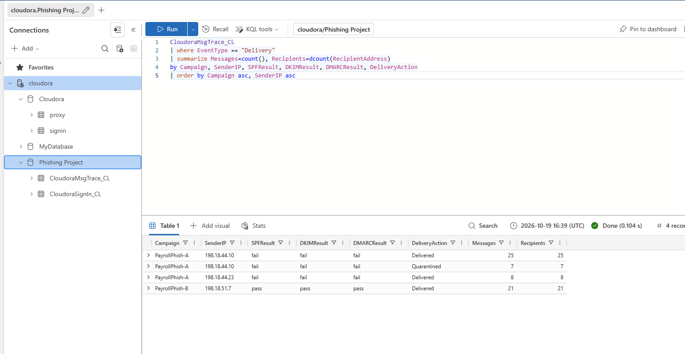
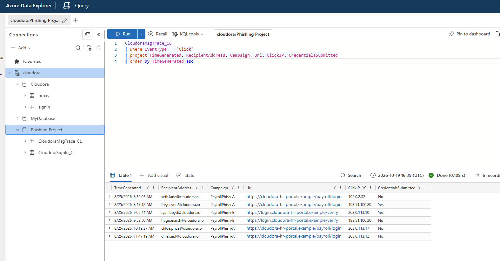
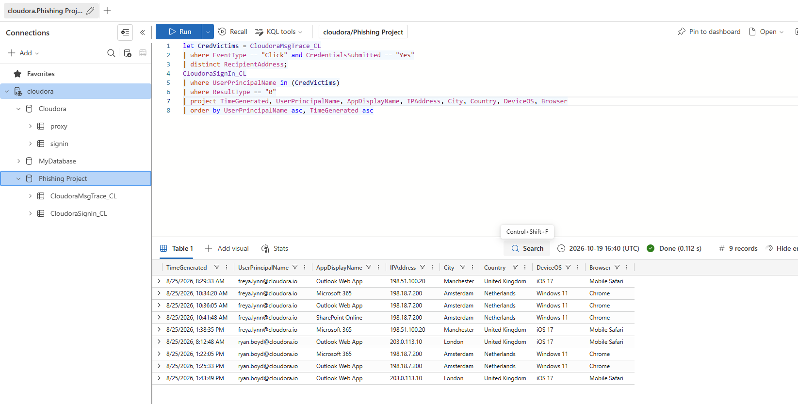
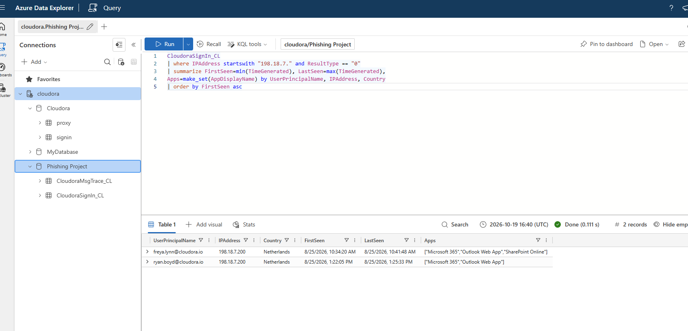

# Cloudora Payroll Phishing Campaign Investigation

**Simulated SOC investigation | Azure Data Explorer (ADX) | Kusto Query Language (KQL)**

> **Training disclosure:** Cloudora is a fictional organization. The logs, accounts, addresses, and phishing infrastructure are synthetic materials from a MyFirstHack training scenario. This is a portfolio lab, **not employment or a live client engagement**.

## Objective
Investigate a payroll-themed phishing campaign using email message-trace and sign-in telemetry. Determine the delivery scope, identify phishing-link clicks and credential submissions, and correlate suspicious successful sign-ins to identify affected accounts.

## Tools and evidence
- Azure Data Explorer free cluster; KQL
- `CloudoraMsgTrace_CL`: message delivery, email authentication and click events
- `CloudoraSignIn_CL`: authentication events and account activity
- Screenshots in [`screenshots/`](screenshots/); reproducible investigation queries in [`queries/investigation.kql`](queries/investigation.kql)

## Investigation process and observed findings

### 1. Scope message delivery and inspect authentication
Grouped `Delivery` events by campaign, sender IP, SPF, DKIM, DMARC, and delivery action. The output shows:

| Campaign | Sender IP | SPF / DKIM / DMARC | Action | Messages |
|---|---|---|---|---:|
| PayrollPhish-A | 198.18.44.10 | fail / fail / fail | Delivered | 25 |
| PayrollPhish-A | 198.18.44.10 | fail / fail / fail | Quarantined | 7 |
| PayrollPhish-A | 198.18.44.23 | fail / fail / fail | Delivered | 8 |
| PayrollPhish-B | 198.18.51.7 | pass / pass / pass | Delivered | 21 |

Passing authentication alone does not establish legitimacy: a lookalike domain can authenticate its own malicious messages.

### 2. Identify users who clicked
Filtered `Click` events and reviewed `CredentialsSubmitted`. **Six click events** were returned; **two** showed `Yes`: `freya.lynn@cloudora.io` and `ryan.boyd@cloudora.io`.

### 3. Correlate phishing victims with sign-ins
Used a KQL `let` expression to identify credential submitters, then inspected their successful sign-ins (`ResultType == "0"`). Results included suspicious activity from `198.18.7.200` in Amsterdam, Netherlands, following the phishing clicks.

### 4. Pivot on the suspicious IP
Grouped successful sign-ins in `198.18.7.*` by account, IP, and country. Both accounts had activity from `198.18.7.200`: Freya's first observed activity at **10:34:20 UTC** and Ryan's at **13:22:05 UTC** on **2026-08-25**. The observed apps included Microsoft 365, Outlook Web App, and SharePoint Online across the two accounts.

## Assessment
The telemetry supports a **simulated credential-phishing incident affecting two accounts**. The combination of credential submission and later successful sign-ins from the same suspicious foreign IP is stronger evidence than a click alone.

## Recommended response (not executed in a live tenant)
1. Revoke sessions and refresh tokens for the affected accounts.
2. Reset passwords and require MFA re-registration.
3. Block malicious sender/hosting/login infrastructure and remove phishing messages.
4. Investigate additional recipients and validate that no suspicious sessions persist.
5. Consider detection logic for a successful sign-in from a new country soon after a phishing-link click.

These are **proposed actions for the simulation**, not evidence of live containment.

## Limitations and next steps
- Screenshots substantiate four KQL investigations; they do not independently demonstrate execution of containment, email-header triage, external threat-intelligence enrichment, or the full written incident response workflow.
- A training-provider completed-example report was supplied as reference, but is **not included or presented as original analyst work**.
- Potential extensions: near-miss recipient list, explicit false-positive validation, a custom click-to-sign-in detection query, and an original incident report.

## Attribution
Scenario and synthetic data: **MyFirstHack / Cloudora Payroll Phishing Campaign** training materials. Investigation documentation and portfolio packaging based on the provided KQL screenshots.
